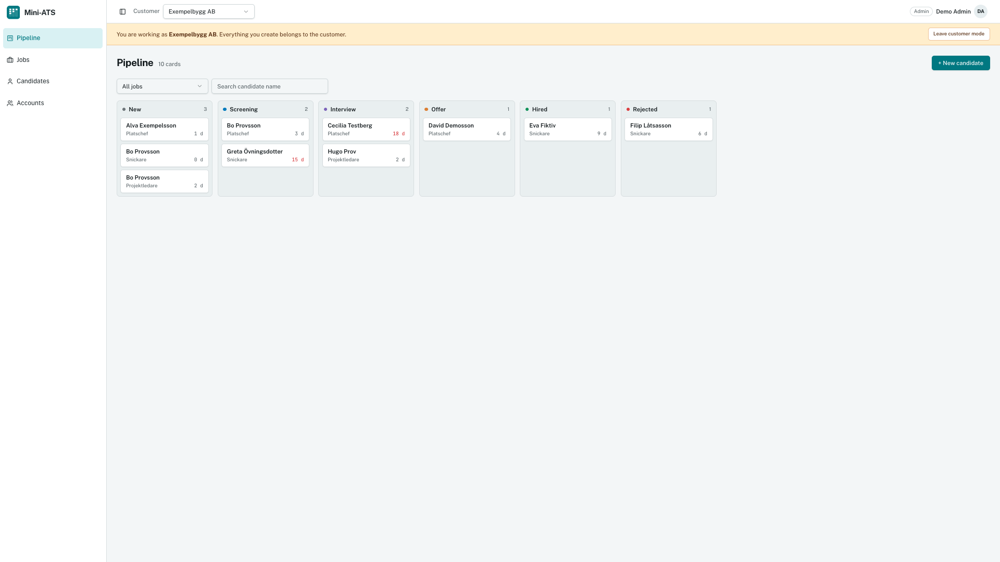
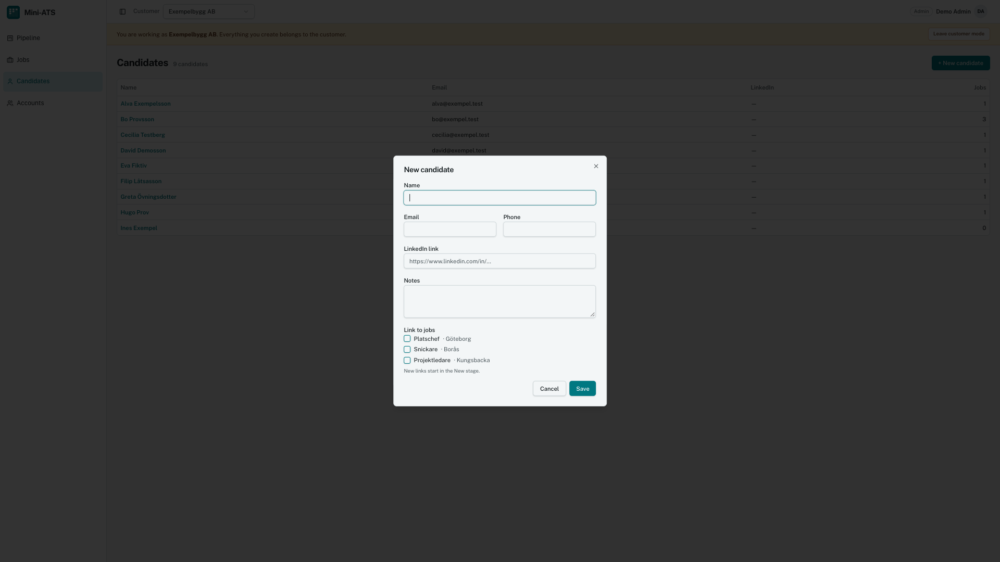
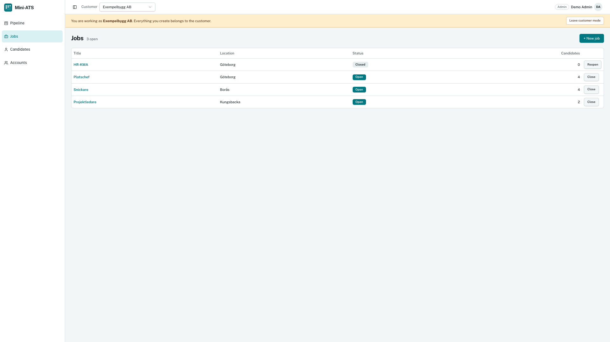
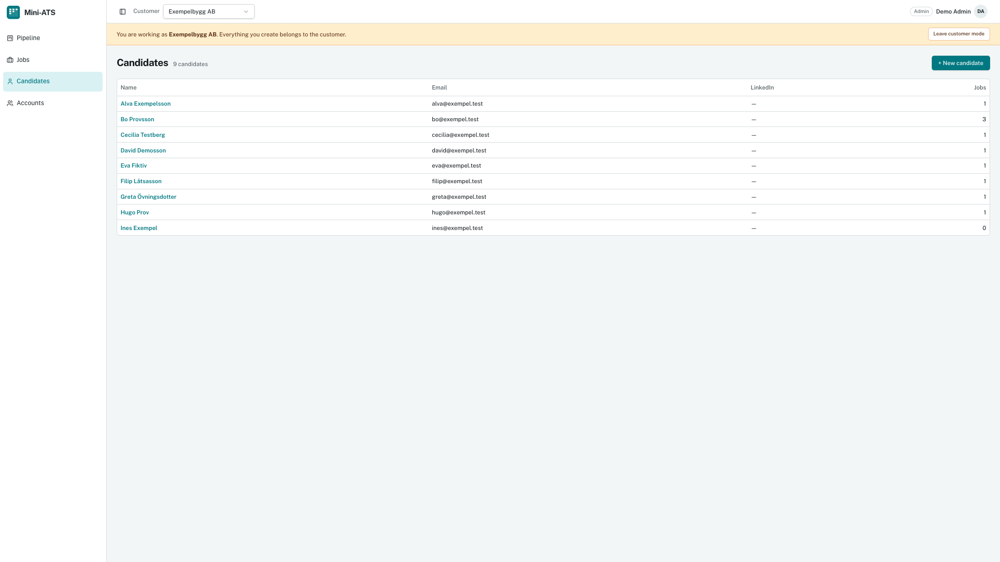
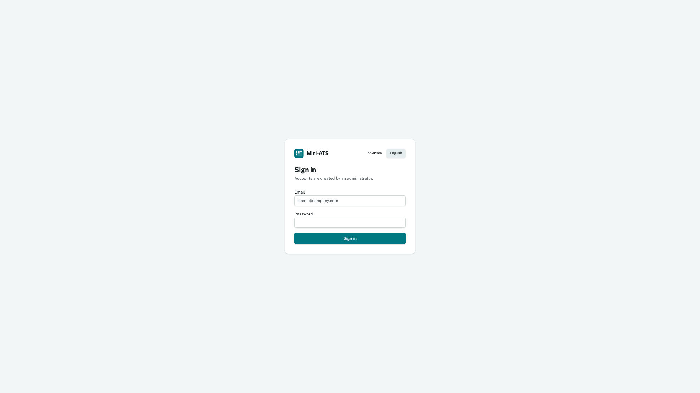
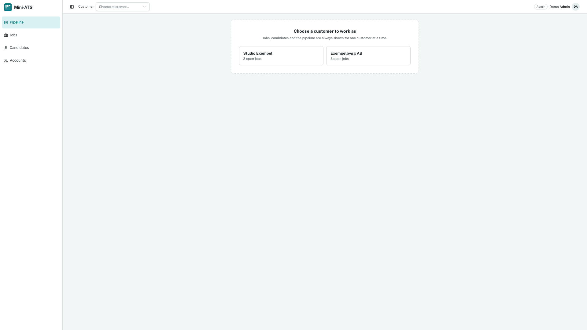
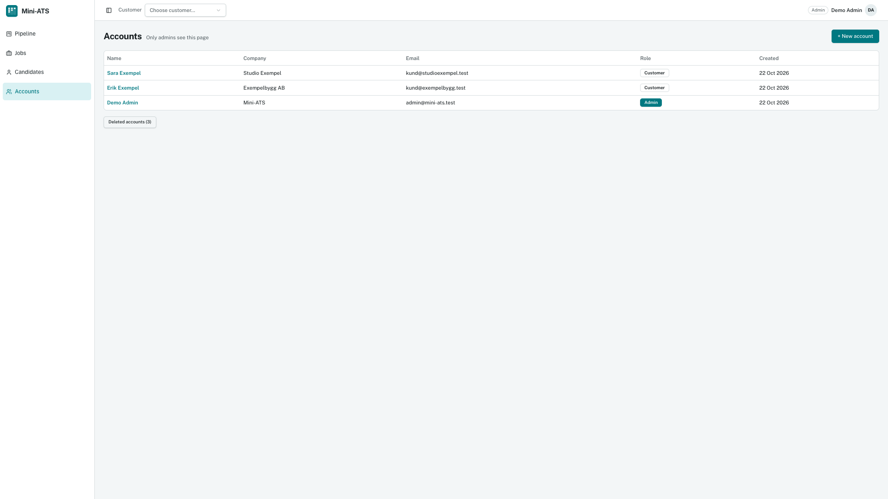
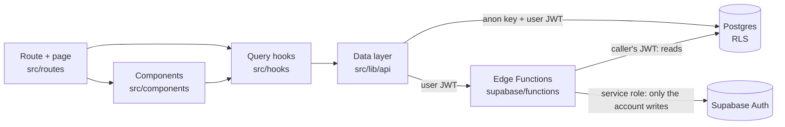

<h1 align="center">
  <picture>
    <source media="(prefers-color-scheme: dark)" srcset="docs/brand/logo-dark.svg">
    
  </picture>
</h1>

<p align="center">
  A small applicant tracking system for companies that recruit.<br>
  Jobs, candidates and a compact kanban pipeline, with one login per company and an admin who can act for any customer.
</p>

<p align="center">
  <a href="https://mini-ats-pi-eosin.vercel.app"><strong>Live app</strong></a> ·
  <a href="#getting-started">Run it locally</a> ·
  <a href="#security">Security</a> ·
  <a href="#how-it-was-built">How it was built</a>
</p>

<p align="center">
  <a href="https://github.com/PatrikNoordh/mini-ats/actions/workflows/ci.yml"></a>
  <a href="https://mini-ats-pi-eosin.vercel.app"></a>
  
  
  
</p>

Built as a code test, in public: every ticket is a [GitHub issue](../../issues) and every change a [pull request](../../pulls).

---

## Contents

- [Screenshots](#screenshots)
- [Features](#features)
- [Tech stack](#tech-stack)
- [Architecture](#architecture)
- [Project structure](#project-structure)
- [Security](#security)
- [Accessibility](#accessibility)
- [Getting started](#getting-started)
- [Scripts](#scripts)
- [Quality and CI](#quality-and-ci)
- [How it was built](#how-it-was-built)
- [Key decisions and tradeoffs](#key-decisions-and-tradeoffs)
- [Assumptions](#assumptions)
- [Out of scope](#out-of-scope)
- [What I would do next](#what-i-would-do-next)
- [Credits and attribution](#credits-and-attribution)

---

## Screenshots

Shown in English, with the demo data. The app starts in Swedish and switches language from the sign-in page.

**Pipeline**: the compact kanban board with a card per candidate and job, and days in the current stage


**New candidate**: name, contact details, notes and the jobs to link to; new links start in New


| Jobs | Candidates |
|---|---|
|  |  |

| Sign in | Admin: choose a customer |
|---|---|
|  |  |

**Admin: accounts**: every account with its company, email and role, and the deleted accounts behind their own button


---

## Features

**For a customer (a recruiting company)**
- **Jobs**: create, edit, close and reopen. A job can be deleted only while no candidates are linked to it, so a board is never emptied by mistake
- **Candidates**: name, email, phone, LinkedIn and notes, linked to one or more jobs. Untick a job to take the candidate off it, after a confirm. Deleting a candidate removes their cards too, after a confirm that says how many
- **Pipeline**: a compact kanban board, `Ny → Screening → Intervju → Erbjudande → Anställd`, plus `Avböjd`
  - Small cards with the candidate's name, the job and the **days in the current stage**
  - **Drag and drop** with mouse, touch or keyboard, with optimistic moves that roll back on a failed save
  - **Filters** for the job and the name, kept in the URL (`?job=&q=`) so a reload or a shared link shows the same board
  - A side panel with the candidate's details and jobs, where a job can be added or removed, and a CV (PDF) uploaded, opened, replaced or removed
  - **AI assessment of the CV** for each job the candidate is linked to: a score from 1 to 10, a summary, strengths and gaps, labelled as an AI suggestion, never a decision

**For the admin (runs the platform)**
- **Accounts** (`Konton`): create admin and customer accounts; edit name, company, email, role and password
- **Delete with 30 days to undo**: a deleted account is hidden, can't sign in and gets no data, but keeps everything. **Borttagna konton** lists it with **Återställ** and **Radera för gott**, and a daily job deletes it for good after 30 days, CV files included
- **Act as a customer**: choose a customer and use every customer screen on their behalf, with a banner saying who you work as. The choice survives a reload

**Everywhere**
- **Change your own password** from the user menu, after typing the current one. Only you know it then, and your other devices are signed out
- **Swedish and English**, Swedish by default
- Every list and the board have **loading, empty and error** states. Errors say what failed and why, for example no internet connection
- Works from a **390 px** phone to a wide desktop

---

## Tech stack

| | Choice | Why |
|---|---|---|
| Framework | **TanStack Start** (React 19, Vite, Nitro) | Lovable's template, kept after the takeover. The server renders the page shell; auth and data load in the browser |
| Routing | **TanStack Router**, file-based | Type-safe routes and search params validated with zod |
| Data | **TanStack Query** | Caching, invalidation and optimistic card moves with rollback |
| Language | **TypeScript** (strict, `exactOptionalPropertyTypes`) | No `any`, no casts to silence errors |
| UI | **Tailwind CSS v4** + **shadcn/ui** | Theme tokens in one file, accessible Radix primitives |
| Drag and drop | **@dnd-kit** | Pointer, touch and keyboard sensors with screen-reader announcements |
| Validation | **zod** | Forms, search params and Edge Function bodies |
| i18n | **i18next** | Swedish and English, every string in both files |
| Backend | **Supabase**: Postgres with RLS, Auth, Storage, Edge Functions (Deno) | The database enforces who sees what |
| Tests | **Vitest** + Testing Library, Deno tests, SQL RLS tests | Logic, components, Edge Functions and the security rules |
| Hosting | **Vercel** | Deploys `main`, a preview for every pull request |

---

## Architecture



| Layer | Folder | Rule |
|---|---|---|
| Routes | `src/routes/` | Path, search param schema, guards and the page |
| Components | `src/components/<feature>/` | Dialogs and page parts, one component per file. Never call Supabase |
| Hooks | `src/hooks/` | TanStack Query hooks. Every key with customer data includes the customer id |
| Data layer | `src/lib/api/` | Every Supabase call, one file per table. Errors become codes |
| Contexts | `src/contexts/` | `AuthContext` (the user and their profile) and `ActiveCustomerContext` |
| Database | `supabase/migrations/` | Schema, RLS policies, triggers and database functions |
| Edge Functions | `supabase/functions/` | `admin-create-user` and `admin-manage-account`, the only code with the service role key |

**Rules that follow from it**
- **Components never fetch.** A page reads data through a hook, and the hook calls `src/lib/api/`.
- **Switching customer never shows the previous customer's data**: every query key includes the active customer id, for example `["jobs", customerId]`.
- **The database sets `customer_id`** where it can: an application gets it from its job, through a trigger. A client can't put a card on another customer's board.
- **Errors are codes, not text.** The database and the Edge Functions return codes such as `job_has_candidates`, and the UI translates them ([`docs/error-codes.md`](docs/error-codes.md)).
- **No hardcoded values**: UI text through `t()`, colours and sizes from the theme tokens in [`src/styles.css`](src/styles.css), and numbers from [`src/lib/constants.ts`](src/lib/constants.ts).

---

## Project structure

```
mini-ats/
├── src/
│   ├── routes/              # login, pipeline, jobs, candidates, admin/accounts
│   ├── components/
│   │   ├── accounts/        # AccountDialog, DeletedAccounts
│   │   ├── auth/            # RequireAuth, RequireAdmin
│   │   ├── candidates/      # CandidateDialog
│   │   ├── jobs/            # JobDialog
│   │   ├── layout/          # AppShell, sidebar, customer picker and chooser, acting banner
│   │   ├── pipeline/        # Board, BoardFilters, CandidateSheet, AddToJob
│   │   └── ui/              # vendored shadcn/ui
│   ├── contexts/            # AuthContext, ActiveCustomerContext
│   ├── hooks/               # useJobs, useCandidates, useApplications, useProfiles, …
│   ├── lib/
│   │   ├── api/             # the Supabase calls, one file per table
│   │   ├── constants.ts     # every limit and delay
│   │   ├── errors.ts        # errors → codes
│   │   └── validation.ts    # zod schemas for the forms
│   ├── locales/             # sv.json, en.json
│   ├── styles.css           # theme tokens
│   └── test/                # Vitest
├── supabase/
│   ├── migrations/          # schema, RLS, triggers, database functions
│   ├── functions/           # admin-create-user, admin-manage-account (+ Deno tests)
│   └── tests/               # rls_test.sql, the concurrency test
├── scripts/                 # the demo seed script
├── docs/                    # UI spec, prototype, error codes, epic reviews
├── CLAUDE.md                # the rules every change follows
└── TICKETS.md               # the plan, epic by epic
```

---

## Security

The security lives in the database, not in the frontend. Hiding a button is UX; **Row Level Security** decides what a request may read or change.

### Roles

- **Admin** and **customer**. The role that counts is `profiles.role`, read in the database through `public.is_admin()`.
- The role is set when an admin creates the account, through `app_metadata`, which only the server can write. A trigger copies it to the profile. A user can't change their own role, and the role is never read from `user_metadata`.
- **Public sign-up is disabled.** Accounts are only created by an admin.

### Row Level Security

- Every table has RLS. A customer sees only rows whose `customer_id` is their own id; an admin sees everything through `is_admin()`.
- A deleted account gets nothing, even with a session it still holds: `account_is_active()` gates every customer row, and a deleted admin is no longer an admin.
- **Explicit table grants**: `anon` has no privileges at all, and `authenticated` only the operations the app uses.
- Triggers set `customer_id` on applications and assessments, and check that a job and a candidate belong to the same customer. Text has length limits in the database too.
- CVs (for the AI feature) go in a private bucket, in a folder per customer, with the same rules.

### Why the service role key only lives in Edge Functions

The service role key bypasses RLS. Anything in the browser can be read by anyone, so the key never reaches `src/` or the bundle; the frontend only has the public anon key, and RLS limits what it can do.

Three things need more power than a user has: creating accounts, changing or deleting them in Auth, and saving an AI assessment of a CV, which clients may only read. Each is an Edge Function that:
1. **checks the caller first**: `is_admin()` for the account functions, a valid session for `assess-cv`, run with the caller's own JWT,
2. **reads with the caller's JWT**, so RLS still applies: `assess-cv` reads the application and downloads the CV as the caller,
3. uses the **service role only for the write** it exists for,
4. validates the body with zod and returns error codes, never internal messages.

`assess-cv` sends only the CV's text and the job to the model (the photo never leaves the PDF), tells it to ignore name, age, gender and anything else not relevant to the job, and checks the JSON answer with zod before saving it.

The demo seed script also uses the key. It runs only on my machine and reads the key from the shell or from a gitignored file, never from `.env.local`, which the app reads.

### How it was tested

- [`supabase/tests/rls_test.sql`](supabase/tests/rls_test.sql) signs in as customer A, customer B, an admin and a signed-out user, and checks **31 rules**. Some examples:
  - B can't read, change, delete or create A's rows
  - a customer can't make itself admin
  - an application always gets its job's customer
  - `anon` can't read any table
  - a deleted account gets no rows
- A **concurrency test** moves cards in parallel and checks that no positions collide.
- Both run in **CI on every pull request**, against a plain Postgres 17 with a small Supabase stand-in. A schema change is also run in the Supabase SQL Editor against the real project before its PR merges.
- The Edge Functions have **Deno tests** for the caller check, validation and every refusal.

---

## Accessibility

- A label on every input, also the filters (visually hidden)
- Everything works by keyboard, including the board: Tab to a card, space to pick it up, arrows to move it, space to drop and Escape to cancel. The moves are announced to screen readers in the chosen language
- Visible focus on every control, and colours from theme tokens chosen for contrast
- Dialogs and the side panel trap focus and close with Escape (Radix)
- Destructive actions ask first, and deleting an account for good needs its name typed

---

## Getting started

### 1. Requirements

- [Node.js](https://nodejs.org) 24 (the version CI uses) and npm
- A [Supabase](https://supabase.com) project (the free plan is enough)

### 2. Clone and install

```bash
git clone https://github.com/PatrikNoordh/mini-ats.git
cd mini-ats
npm install
```

### 3. Set up Supabase

```bash
npx supabase login
npx supabase link --project-ref <your-project-ref>
npx supabase db push                                    # schema, RLS, triggers
npx supabase functions deploy admin-create-user
npx supabase functions deploy admin-manage-account
npx supabase functions deploy purge-deleted-accounts
npx supabase secrets set PURGE_CRON_SECRET=<a long random value, e.g. from openssl rand -hex 32>
npx supabase functions deploy assess-cv
npx supabase secrets set ANTHROPIC_API_KEY=<your Anthropic API key>
```

The daily purge runs in the `purge-deleted-accounts` Edge Function, because only the Storage API can remove the CV files. `pg_cron` calls it through `pg_net`, with three Vault secrets. Set them once in the **SQL Editor**:

```sql
select vault.create_secret('https://<your-project-ref>.supabase.co', 'project_url');
select vault.create_secret('<the anon key>', 'anon_key');
select vault.create_secret('<the same value as PURGE_CRON_SECRET>', 'purge_cron_secret');
```

In the Supabase Dashboard:
- **Authentication → Sign In / Providers → Email**: turn off **Allow new users to sign up**.
- **Database → Extensions**: `pg_cron` and `pg_net` run the daily purge of deleted accounts. The migration turns them on where they're available.

### 4. Add your keys

```bash
cp .env.example .env.local
```

```env
VITE_SUPABASE_URL=https://<your-project-ref>.supabase.co
VITE_SUPABASE_ANON_KEY=<the anon / publishable key>
```

Both come from **Project Settings → API**. The service role key never goes in this file.

### 5. Create the first admin

Either run the demo seed script, which creates an admin, two customers and their data:

```bash
# SUPABASE_SERVICE_ROLE_KEY in your shell, or in .env.seed.local (gitignored)
npm run seed:demo -- --yes
```

Or add a user under **Authentication → Users** in the Dashboard and promote it in the SQL Editor:

```sql
update public.profiles set role = 'admin' where email = '<email>';
```

### 6. Run it

```bash
npm run dev     # http://localhost:8080
```

### Deploying

The repository is connected to Vercel: every push to `main` deploys the live app and every pull request gets a preview. Set `VITE_SUPABASE_URL` and `VITE_SUPABASE_ANON_KEY` for Production and Preview. Nitro builds for Vercel without extra configuration.

---

## Scripts

| Command | What it does |
|---|---|
| `npm run dev` | Dev server with hot reload |
| `npm run build` | Production build (no type check, see `tsc` below) |
| `npx tsc --noEmit` | Type check |
| `npm run lint` | ESLint |
| `npm test` | Vitest, once |
| `npm run test:watch` | Vitest in watch mode |
| `npm run format` | Prettier |
| `npm run seed:demo -- --yes` | Create or rebuild the demo accounts and data |

---

## Quality and CI

[`.github/workflows/ci.yml`](.github/workflows/ci.yml) runs three jobs on every pull request and push to `main`:

1. **App**: `npm ci` → lint → `tsc --noEmit` → `npm test` → `npm run build`
2. **Edge Functions**: `deno check` on every function and `deno test` on all of `supabase/functions`
3. **RLS**: Postgres 17 → the Supabase stand-in → every migration → `rls_test.sql` → the two concurrency tests

A pull request merges only when all three are green and the Vercel preview works. Over **320 Vitest tests** cover the logic and components: validation, the URL filters, days in stage, card moves and rollback, error codes, the customer switch, offline saves, the account dialogs, CVs and the AI assessment. A test also checks that `sv.json` and `en.json` have the same keys and placeholders. The Edge Functions have their own Deno tests, which run with every outside call passed in, so they need no project.

One convention worth knowing: a `beforeEach` or `beforeAll` callback has a block body. Vitest runs a function returned from it as cleanup, so `beforeEach(() => mock.mockReset())` would call the mock again after the test. ESLint enforces this in `src/test/`.

---

## How it was built

**Lovable built the UI** from my spec ([`docs/ui-spec.md`](docs/ui-spec.md)) and a visual prototype ([`docs/prototype.html`](docs/prototype.html)), with mock data and no backend. When the free Lovable credits ran out, **Claude Code took over**. It reviewed the Lovable code against the spec ([`docs/review-ats-1.md`](docs/review-ats-1.md)), and wrote the rest: the Supabase schema and RLS, the Edge Functions, the data layer, the fixes and the tests.

**My part was to direct, test and set the rules:**
- I wrote the spec and the ticket plan ([`TICKETS.md`](TICKETS.md)), split into epics with acceptance criteria.
- I set the rules every change follows in [`CLAUDE.md`](CLAUDE.md): the security rules, no hardcoded values, small commits and one branch per ticket.
- I made the product decisions, for example that a job with candidates can't be deleted and that deleted accounts are kept for 30 days.
- I approved every database change before it reached the project, and ran the manual tests as admin and as customer before each merge.

**The workflow**, run with project skills in [`.claude/skills/`](.claude/skills):
1. A ticket becomes a GitHub issue.
2. It's implemented on its own branch, in small commits that each pass lint, types, tests and build.
3. Claude self-reviews the whole diff before a pull request is opened.
4. I test it, and it merges once CI is green.

After each epic, a review ([`docs/review-epic-0.md`](docs/review-epic-0.md) to [`docs/review-epic-4.md`](docs/review-epic-4.md)) checks the epic as a whole. Problems found along the way are listed in `TICKETS.md` and triaged into tickets at the next checkpoint, so they never get lost and never bloat a ticket.

---

## Key decisions and tradeoffs

| Decision | Why | Tradeoff |
|---|---|---|
| **Kept Lovable's TanStack Start** instead of the React Router the spec named | It worked, and a rewrite would cost days for no user value | Server rendering is barely used: the server only renders the shell |
| **Auth and data in the browser** | Supabase's RLS is the security either way, and it keeps the server stateless | Protected pages show a loading state before the session is read |
| **RLS as the only access control** | One place to get right, tested in CI | Every table and policy needs a matching SQL test |
| **One login per company** | Matches the brief, and keeps `customer_id = auth.uid()` simple | Several users per company needs a new table (see next) |
| **Card moves through a database function** (`move_application`) | Stage, position and `stage_changed_at` in one locked call; no two cards get the same position | More SQL than an `update` from the client |
| **Optimistic card moves** | The board feels instant | A failed save rolls the card back with a toast |
| **Edge Functions only for Auth writes** | Least privilege: the service role key does one thing per function | Account changes need a function deploy, not just a migration |
| **Soft delete for accounts, 30 days** | A deleted company can be restored with all its data | A login ban in Auth and a database flag that must agree |
| **A job with candidates can't be deleted** | Nobody empties a board by mistake | Two steps to remove a job with candidates |
| **Error codes instead of messages** | Translated in both languages; no internal details leak | Every new error needs a code, a translation and a doc line |
| **Saves fail fast when offline** | A clear error instead of a spinner that never stops | No offline queue |

---

## Assumptions

- A customer is a **company with one shared login**, as in the brief.
- Customers are **Swedish companies**, so Swedish is the default language, with English for everyone else.
- **Admins create every account**, and give the customer their login in person. There are no email invites.
- A candidate belongs to **one customer**, and can be in several of that customer's jobs.
- The AI assessment of a CV is **a suggestion for the recruiter**, never a decision.
- The product is called **Mini-ATS**, as in the brief. The name lives in one translation key (`app.name`), so it can change in one place when the product gets a real name. Each customer sees their own company name in the header, taken from their account.

---

## Out of scope

- Several users per company, and roles inside a company
- Email: invites, password reset, notifications to candidates
- A careers page or a public way for candidates to apply
- Interview scheduling, calendars and offer letters
- Reporting, an audit log, and GDPR tools such as exports and retention rules for candidates
- Billing and plans

---

## What I would do next

| | |
|---|---|
| **End-to-end tests** | Playwright runs of sign-in, the board and acting for a customer, against a preview database |
| **Teams** | Several users per company with a members table, which changes `customer_id = auth.uid()` to a membership check in RLS |
| **Audit log** | Who moved, changed or deleted what, and when |
| **Email** | Invites and password reset through Supabase Auth, once accounts aren't handed out in person |

---

## Credits and attribution

Mini-ATS is a code test (2026) by [Patrik Noordh](https://github.com/PatrikNoordh). I wrote the spec and the rules, made the product decisions and tested every change. The UI was first built with [Lovable](https://lovable.dev), and the code since then with [Claude Code](https://claude.com/claude-code) (see [How it was built](#how-it-was-built)).

Built on open source:
- [TanStack](https://tanstack.com) Start, Router and Query (MIT)
- [Supabase](https://supabase.com): Postgres, Auth, Storage and Edge Functions (`supabase-js`, MIT)
- [shadcn/ui](https://ui.shadcn.com) and [Radix UI](https://www.radix-ui.com) components (MIT)
- Drag and drop by [dnd-kit](https://dndkit.com) (MIT)
- Icons by [Lucide](https://lucide.dev) (ISC)
- Toasts by [Sonner](https://sonner.emilkowal.ski) (MIT)
- Translations with [i18next](https://www.i18next.com) (MIT)
- Typefaces [Public Sans](https://public-sans.digital.gov) and [JetBrains Mono](https://www.jetbrains.com/lp/mono/) (SIL Open Font License), from Google Fonts

All people, companies, jobs and candidates in the demo and the screenshots are made up. Any likeness to real ones is a coincidence.
